<p align="center">
  
</p>

# syntropic137

Zero-dependency self-host setup CLI for [Syntropic137](https://github.com/syntropic137/syntropic137). One command to go from nothing to a fully running stack.

```
npx @syntropic137/setup init
```

**Prerequisites:** Node 20.12+ and Docker (with Compose v2.20+). That's it. On an older Node, setup stops at once and says so.

## What it does

The `init` command walks you through a 13-step interactive setup:

1. **Check Docker:** verifies Docker and Compose v2.20+ are installed and running
2. **Create directory:** sets up `~/.syntropic137/` with the required structure
3. **Copy templates:** writes the Docker Compose file, entrypoint script, env template, and database init SQL
4. **Generate secrets:** creates cryptographically random passwords for Postgres, Redis, and MinIO (files 0644 inside a 0700 `secrets/` directory, so the containers can read them and no other host user can)
5. **Configure LLM provider:** prompts for your Anthropic API key (or picks up `ANTHROPIC_API_KEY` from your environment)
6. **Configure Codex (optional):** asks "Enable Codex phases?" and stores a Codex `auth.json` as `CODEX_AUTH_JSON` or, once the platform supports it, an OpenAI API key as `OPENAI_API_KEY`, so workflows with `agent.provider: codex` can run (see [Codex credential](#codex-credential))
7. **GitHub App setup:** runs the [GitHub App Manifest flow](https://docs.github.com/en/apps/sharing-github-apps/registering-a-github-app-from-a-manifest) to create a GitHub App with the right permissions in one click (optional, skippable)
8. **Agent skills:** installs the [Syntropic137 agent skills](https://github.com/syntropic137/syntropic137-skills) globally for Claude Code and Codex, whichever you have (optional, skippable)
9. **Syntropic137 CLI:** installs the `syn` CLI for managing workflows and executions (optional, skippable)
10. **Write .env:** renders the final configuration from your answers
11. **Pull images:** `docker compose pull` from GHCR
12. **Start services:** `docker compose up -d`
13. **Health check:** polls `http://localhost:8137/health` until the stack is ready

When it's done, you have a running Syntropic137 instance at `http://localhost:8137`.

## Options

```
npx @syntropic137/setup init [options]

--org <name>          Create the GitHub App under an org (default: personal account)
--name <app-name>     GitHub App name (default: syntropic137)
--dir <path>          Install directory (default: ~/.syntropic137)
--skip-github         Skip GitHub App creation
--skip-docker         Skip image pull and container startup (templates only)
--install-cli         Install the syn CLI without asking (--no-install-cli skips it)
--webhook-url <url>   Set a webhook URL for the GitHub App
--codex-auth-file <path>
                      Store this Codex auth.json as CODEX_AUTH_JSON
--openai-api-key-env <VAR>
                      Store the OpenAI API key held in env var VAR as OPENAI_API_KEY
                      (takes the variable name, never the key itself)
--skip-codex          Skip the Codex credential step
-y, --yes             Answer yes instead of asking (e.g. install the agent skills and the syn CLI without a terminal)
```

## Lifecycle commands

After initial setup, manage your stack with:

```sh
npx @syntropic137/setup status       # Container health (docker compose ps) and agent skills state
npx @syntropic137/setup stop         # Stop the stack
npx @syntropic137/setup start        # Start the stack
npx @syntropic137/setup logs         # Tail container logs
npx @syntropic137/setup update       # Pull latest images and restart
npx @syntropic137/setup credentials  # View, rotate, or roll back credentials
npx @syntropic137/setup codex        # Add or replace the Codex credential
npx @syntropic137/setup skills       # Install or update the agent skills (also: skills status)
npx @syntropic137/setup reset        # Factory reset (dry run until you add --yes)
```

All commands accept `--dir <path>` if your install directory isn't the default `~/.syntropic137`.

## Agent skills (Claude Code and Codex)

The [Syntropic137 agent skills](https://github.com/syntropic137/syntropic137-skills) teach your coding agent to drive the platform: run workflows, follow executions, read sessions, and set up GitHub triggers. `init` offers to install them, and you can manage them any time:

```sh
npx @syntropic137/setup skills          # install for every agent found (claude, codex)
npx @syntropic137/setup skills update   # refresh to the latest skills
npx @syntropic137/setup skills status   # what is installed, and where
```

Under the hood this runs the [`skills`](https://www.npmjs.com/package/skills) CLI, pinned to an exact version, as a user-level (global) install. It detects `claude` and `codex` on your `PATH` and installs for whichever you have. To run it yourself:

```sh
npx -y skills@1.7.0 add syntropic137/syntropic137-skills --skill '*' -g -a claude-code -a codex -y
```

The skills CLI needs Node 20.12 or newer. A failed skills install never stops `init`; it prints a warning and this command instead. Without a terminal to ask in, `init` skips the skills unless you pass `--yes`.

Without a terminal, `init` never waits on a prompt: it reads the Anthropic credential from `ANTHROPIC_API_KEY` or `CLAUDE_CODE_OAUTH_TOKEN` if set and otherwise skips it, stores a Codex credential only from `--codex-auth-file`, `--openai-api-key-env` or a `CODEX_AUTH_JSON` environment variable (`--yes` alone does not enable Codex), and installs the syn CLI only with `--yes`. The final summary lists anything still needed before a first workflow run.

**Upgrading from the Claude Code plugin:** earlier versions installed a Claude Code plugin (`syntropic137@syntropic137`). The skills replace it, and keeping both duplicates commands. The `skills` step detects the plugin and offers to run `claude plugin uninstall syntropic137@syntropic137` and `claude plugin marketplace remove syntropic137` for you, but only after the skills installed successfully. Without a terminal to ask in, it only prints those commands unless you pass `--yes`. The old `plugin` subcommand still works as a deprecated alias for `skills`.

## Codex credential

Codex phases (`agent.provider: codex`) need a credential of their own. `init` offers one right after the Anthropic step, and `npx @syntropic137/setup codex` adds or replaces it later (then run `start` to apply it). Setup stores exactly one of:

| Credential | Stored as | For |
|------------|-----------|-----|
| A Codex `auth.json` | `CODEX_AUTH_JSON` (the JSON on one line) | A Codex or ChatGPT plan login |
| An OpenAI API key (`sk-...`) | `OPENAI_API_KEY` | Pay as you go, no Codex plan needed |

**The OpenAI API key needs a newer platform:** the platform reads `OPENAI_API_KEY` for codex phases only from the release that includes [syntropic137/syntropic137#1971](https://github.com/syntropic137/syntropic137/issues/1971). Setup therefore offers and accepts an API key only when the install's `docker-compose.syntropic137.yaml` passes `OPENAI_API_KEY` to the same service that receives `CODEX_AUTH_JSON`. The template vendored today does not, so an API key is refused with that reason and nothing is stored; use an `auth.json`. The option turns on by itself once the templates are synced from that release.

At the prompt, paste the path to an `auth.json` (a one-line JSON object also works) or, when supported, an API key. Surrounding quotes are dropped. Setup checks that the JSON parses and has an `auth_mode` field, refuses an Anthropic key, and never prints what you pasted, even when it is not recognised. Like the Anthropic credential, it goes into `.env`, which every write leaves at 0600. The `codex` command removes the other key when it writes one, so the two never disagree.

**This machine's `~/.codex/auth.json`** (or `$CODEX_HOME/auth.json`): when it exists, `init` offers it.

- A plan login is offered only after a warning, and the question defaults to no: this machine and the platform would share one single-use refresh token, so whichever refreshes second is logged out with `refresh_token_reused` ([syntropic137/syntropic137#893](https://github.com/syntropic137/syntropic137/issues/893)). Prefer a dedicated login, `CODEX_HOME=$(mktemp -d) codex login`, and give setup the `auth.json` it writes, or an API key. The same warning and question apply when the same login arrives another way (pasted, `--codex-auth-file`, or `CODEX_AUTH_JSON`).
- An API-key login (`{"auth_mode":"apikey","OPENAI_API_KEY":...}`) has no refresh token, so it is offered as an API key, with no warning, when the install supports API keys. Otherwise setup says so and does not offer it.

**Without a terminal (agents):**

```sh
npx @syntropic137/setup init --codex-auth-file ~/codex-dedicated/auth.json
OPENAI_KEY_FOR_SYN=... npx @syntropic137/setup init --openai-api-key-env OPENAI_KEY_FOR_SYN
```

`--openai-api-key-env` takes the name of a variable, so the key never appears in the process arguments. An `OPENAI_API_KEY` already in your shell is not picked up on its own. Without a terminal, this machine's own plan login (passed with `--codex-auth-file` or as `CODEX_AUTH_JSON`) prints the warning and is used only with `--yes`. Pass at most one of `--codex-auth-file`, `--openai-api-key-env` and `--skip-codex`. The `codex` command refuses `--skip-codex`.

`init` ends by showing `Codex enabled` with the credential type, or `Codex skipped` with the command to add it later: in the final summary, or as the last line with `--skip-docker`.

## How the GitHub App Manifest flow works

When you don't pass `--skip-github`, the CLI creates a GitHub App automatically. Make sure you are logged in to GitHub before the browser opens.

1. A local HTTP server starts on a random port (bound to `127.0.0.1` only)
2. Your browser opens to a local page that auto-submits a form to GitHub with the app manifest (permissions, events, callback URL)
3. GitHub shows you a "Create App" confirmation page, then you click Create
4. GitHub redirects back to the local server with a temporary code
5. The CLI exchanges that code for the app's credentials (private key, webhook secret, client secret) via the GitHub API
6. Credentials are saved to `~/.syntropic137/secrets/`, inside the 0700 directory: the PEM 0644 (the API container reads it as a non-root user), the webhook and client secrets created 0600
7. Your browser opens the app's installation page so you can choose which repos to grant access

The private key (PEM) is bind-mounted read-only into the containers that need it as a Compose file secret, at `/run/secrets/github_app_private_key`. Installation IDs are resolved dynamically at runtime, so the app can be installed across multiple orgs and repos. Repositories granted to the installation are listed from GitHub on demand, without requiring a webhook URL.

## What gets installed

Everything lives in `~/.syntropic137/`:

```
~/.syntropic137/
├── docker-compose.syntropic137.yaml   # Full stack definition
├── selfhost-entrypoint.sh             # Secret injection at container startup
├── selfhost.env.example               # Reference template
├── .env                               # Your configuration (chmod 600)
├── .env.backup                        # Copy of .env taken before a rotation (rollback restores from secrets/*.secret.bak)
├── init-db/
│   └── 01-create-databases.sql        # Database schema
├── secrets/
│   ├── db-password.secret             # Postgres password (0644; dir is 0700)
│   ├── redis-password.secret          # Redis password (0644; dir is 0700)
│   ├── minio-password.secret          # MinIO password (0644; dir is 0700)
│   └── github-app-private-key.pem     # GitHub App private key (0644; dir is 0700)
└── workspaces/                        # Agent workspace mount
```

To uninstall, use `reset` (below).

## Factory reset

`reset` returns the machine to a fresh state so the next `init` starts from nothing. It is a dry run by default: it lists exactly what it would remove and removes nothing.

```sh
npx @syntropic137/setup reset               # dry run: show what would be removed
npx @syntropic137/setup reset --yes         # do it
npx @syntropic137/setup reset --all --yes   # also images, the syn CLI and the agent skills
```

| Target | Selected by | What happens |
|--------|-------------|--------------|
| Install directory | always | moved first to `<dir>.backup-YYYYMMDD-HHMMSS` (chmod 700, it holds your secrets); `--no-backup` deletes it last, and only if the Docker cleanup succeeded |
| Selfhost compose project | always | containers, networks and volumes labelled `com.docker.compose.project=syntropic137_selfhost`, removed by name |
| `ghcr.io/syntropic137/*` images | `--images` | `docker image rm`. Shared images the install also pulled (its third-party images, the agent workspace images) are listed with the command to remove them, not removed |
| syn CLI | `--cli` | `npm uninstall -g @syntropic137/cli` |
| Agent skills | `--skills` | removes the Syntropic137 skills with the pinned `skills` CLI; your other skills are untouched |

`--all` is `--images --cli --skills`. `--dir <path>` resets a non-default install.

Safety rails:

- Only resources labelled with the `syntropic137_selfhost` compose project are touched. Reset refuses to run if the installed compose file names a different project, and it never runs `docker compose down`.
- Reset refuses the filesystem root, your home directory (or anything containing it), a symlink, and any existing directory that has neither the Syntropic137 compose file nor the selfhost `.env` that `init` writes.
- If the backup cannot be made, nothing is removed. If Docker is not running, `--yes` refuses rather than strand the stack's containers and volumes. If a Docker listing fails, reset stops instead of guessing.
- Unknown arguments and a `--dir` without a value are errors, never ignored.
- **The GitHub App on github.com is never touched.** Reset prints its settings URL so you can delete it (Advanced, then Delete GitHub App), or keep the backup to reuse it: the private key stays in `<backup>/secrets/`.

## The stack

The Docker Compose file runs these services:

| Service | Image | Purpose |
|---------|-------|---------|
| TimescaleDB | `timescale/timescaledb` | Unified Postgres database (event store + observability) |
| Event Store | `ghcr.io/syntropic137/event-store` | gRPC event sourcing server |
| Collector | `ghcr.io/syntropic137/syn-collector` | Agent event ingestion |
| API | `ghcr.io/syntropic137/syn-api` | Query and control service |
| Gateway | `ghcr.io/syntropic137/syn-gateway` | nginx reverse proxy + dashboard UI |
| MinIO | `ghcr.io/syntropic137/minio` | S3-compatible artifact storage |
| Redis | `redis:7-alpine` | Caching and pub/sub |
| Envoy Proxy | `ghcr.io/syntropic137/sidecar-proxy` | Shared credential injection proxy |
| Token Injector | `ghcr.io/syntropic137/token-injector` | ext_authz service for agent credentials |
| Docker Socket Proxy | `tecnativa/docker-socket-proxy` | Restricted Docker API access for the API service |

Optional: Cloudflare Tunnel (set `COMPOSE_PROFILES=tunnel` in `.env` for remote access).

## Security

This repo is the supply chain entry point for every `npx @syntropic137/setup` user. It is deliberately isolated from the main platform repo. See [SECURITY.md](./SECURITY.md) for the full threat model.

- **Zero runtime dependencies:** Node 20.12+ stdlib only. Nothing to hijack in the dependency tree.
- **Separate repo from the platform:** compromising the main Syntropic137 repo does not grant npm publish access. The cross-repo dispatch token can trigger workflow runs here but cannot push code, merge PRs, or alter what gets published.
- **Publish only deploys reviewed code:** npm publish deploys whatever is on `main`. Since the dispatch token has no write access to repository contents, it cannot inject malicious code into the publish pipeline. The only path to `main` is through a human-reviewed PR.
- **Trusted Publishing (OIDC):** no npm token is stored anywhere. Every published version includes a signed [provenance attestation](https://docs.npmjs.com/generating-provenance-statements) linking it to the exact commit and workflow run. Verify with `npm audit signatures`.
- **Service secrets in files:** the Postgres, Redis and MinIO passwords and the GitHub App key are separate files (0644 inside a 0700 `secrets/` directory), bind-mounted into containers as Compose file secrets. The gateway password, Anthropic credential, Codex credential, webhook secret and tunnel token live in `.env`, which `init` creates as 0600.
- **No auto-publish:** npm releases require a manual `workflow_dispatch` trigger. Template syncs from upstream open a PR but never auto-merge or auto-publish.

## Contributing

See [docs/development.md](./docs/development.md) for build instructions, source structure, and architecture.

## License

MIT
